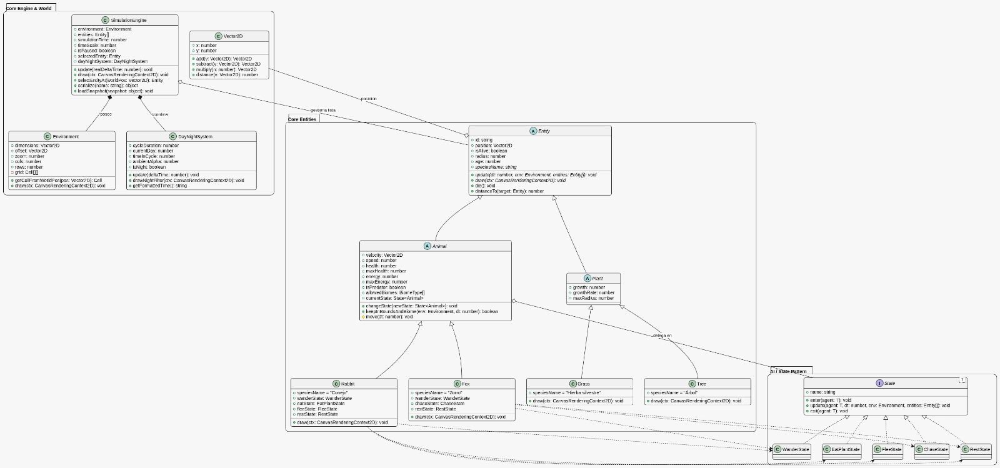
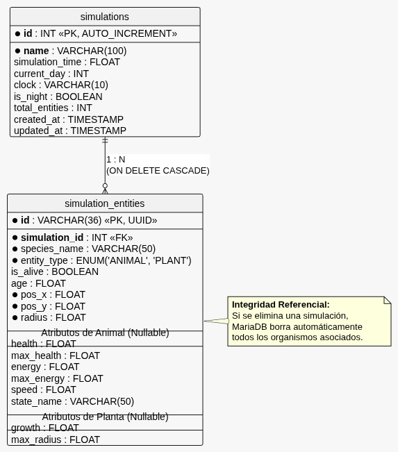
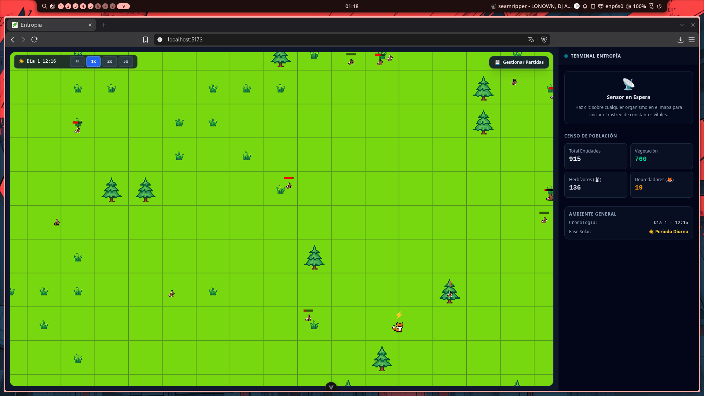

# Entropía - Simulador de Ecosistema 2D

Entropía es una plataforma de simulación de ecosistemas en tiempo real ejecutada sobre HTML5 Canvas y Vue 3, respaldada por un servidor Node.js/Express y persistencia relacional en MariaDB. El proyecto modela interacciones tróficas, ciclos biogeoquímicos y comportamientos biológicos autónomos mediante máquinas de estado finito (FSM) y cinemática vectorial determinista.

---

## Objetivo del Proyecto

Desarrollar un entorno computacional interactivo para modelar la dinámica poblacional y el equilibrio ecológico entre productores primarios (flora) y consumidores (herbívoros y carnívoros) dentro de un mapa segmentado por biomas.

El sistema resuelve tres retos de ingeniería de software:
1. **Rendimiento desacoplado:** La simulación y las físicas vectoriales operan a 60 FPS dentro de un bucle de animación independiente, aislando el cómputo intensivo del árbol reactivo (Virtual DOM) de Vue.
2. **Modularidad del comportamiento (Patrón State):** Los agentes biológicos delegan su toma de decisiones a estados desacoplados e intercambiables (búsqueda de alimento, alimentación, huida, caza y reposo).
3. **Persistencia por instantáneas (Snapshot Model):** Almacenamiento periódico y bajo demanda del estado completo del mundo en una base de datos relacional sin degradar la tasa de cuadros por segundo.

---

## Diagramas de Arquitectura

### 1. Diagrama de Clases UML
Modela la jerarquía orientada a objetos del núcleo (`SimulationEngine`, `Environment`, `Entity`, `Animal`, `Plant`), el cálculo cinemático con `Vector2D` y la implementación del patrón State para la inteligencia artificial.



### 2. Modelo Relacional de Base de Datos (MariaDB)
Estructura de persistencia basada en una relación de uno a muchos entre la sesión de simulación y las entidades instanciadas, con integridad referencial en cascada.



---

## Captura de Pantalla

Demostración del simulador en ejecución mostrando la cuadrícula de biomas, los agentes activos, el ciclo día/noche con filtro atmosférico y el panel lateral de telemetría e inspección en tiempo real.



---

## Instalación y Despliegue

### Requisitos Previos
* Node.js v18.0.0 o superior
* npm v9.0.0 o superior
* MariaDB Server v10.5 o superior

---

### 1. Configuración de la Base de Datos

Inicie su instancia de MariaDB y ejecute el script DDL para inicializar el esquema:

```sql
CREATE DATABASE IF NOT EXISTS entropia_db CHARACTER SET utf8mb4 COLLATE utf8mb4_unicode_ci;
USE entropia_db;

CREATE TABLE IF NOT EXISTS simulations (
    id INT AUTO_INCREMENT PRIMARY KEY,
    name VARCHAR(100) NOT NULL,
    simulation_time FLOAT DEFAULT 0.0,
    current_day INT DEFAULT 1,
    clock VARCHAR(10) DEFAULT '00:00',
    is_night BOOLEAN DEFAULT FALSE,
    total_entities INT DEFAULT 0,
    created_at TIMESTAMP DEFAULT CURRENT_TIMESTAMP,
    updated_at TIMESTAMP DEFAULT CURRENT_TIMESTAMP ON UPDATE CURRENT_TIMESTAMP
);

CREATE TABLE IF NOT EXISTS simulation_entities (
    id VARCHAR(36) PRIMARY KEY,
    simulation_id INT NOT NULL,
    species_name VARCHAR(50) NOT NULL,
    entity_type ENUM('ANIMAL', 'PLANT') NOT NULL,
    is_alive BOOLEAN DEFAULT TRUE,
    age FLOAT DEFAULT 0.0,
    pos_x FLOAT NOT NULL,
    pos_y FLOAT NOT NULL,
    radius FLOAT NOT NULL,
    health FLOAT NULL,
    max_health FLOAT NULL,
    energy FLOAT NULL,
    max_energy FLOAT NULL,
    speed FLOAT NULL,
    state_name VARCHAR(50) NULL,
    growth FLOAT NULL,
    max_radius FLOAT NULL,
    FOREIGN KEY (simulation_id) REFERENCES simulations(id) ON DELETE CASCADE
);